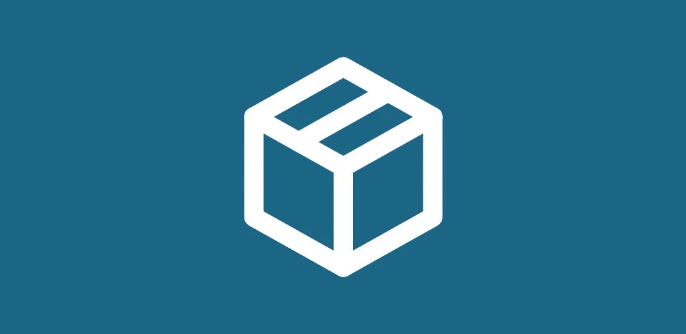

<!--
  ======================================================================
   VD Modules  ::  the MMRL repository for VD171's root modules
   KernelSU, APatch and Magisk modules by VD171, distributed through MMRL.

   Copyright (C) 2026  VD171
   SPDX-License-Identifier: GPL-3.0-or-later

   Licensed under the GNU GPL-3.0-or-later. See the LICENSE file.

   Site           : https://vd171.ru
   Site           : https://vd.priv8.ru
   Source         : https://github.com/VD171/VD-Modules
   GitHub         : @VD171 https://github.com/VD171
   XDA-Developers : @VD171 https://xdaforums.com/m/vd171.4699873/
   Telegram       : @VD_Priv8 https://t.me/VD_Priv8
   Channel        : @Priv8_VD https://t.me/Priv8_VD
   Discord        : @VD.Priv8 https://discord.com/users/1296831918989639721
   E-mail         : vd.priv8@pm.me
  ======================================================================
-->

# VD Modules

<p align="center">
  
</p>

<p align="center">
  <a href="LICENSE"></a>
  <a href="https://github.com/VD171/VD-Modules/stargazers"></a>
  
</p>

<p align="center">
  <b>Every VD171 module, one tap away.</b><br>
  The MMRL repository for VD171's KernelSU, APatch and Magisk modules, with updates delivered straight to your root manager.
</p>

<p align="center">
  <a href="#add-this-repository">Add to MMRL</a> ·
  <a href="#modules">Modules</a> ·
  <a href="https://github.com/MMRLApp/MMRL">MMRL app</a> ·
  <a href="https://t.me/Priv8_VD">Channel</a>
</p>

---

## What this is

VD Modules is the official module repository for VD171, built on the MMRL (Magisk Module Repo Loader) format. Add it once and your root manager keeps every VD171 module up to date on its own: no manual flashing, no hunting for the latest release.

It works with KernelSU, APatch and Magisk.

## Add this repository

1. Install [MMRL](https://github.com/MMRLApp/MMRL), or any MMRL compatible client.
2. Open **Repositories** and add this URL:
   ```
   https://vd171.github.io/VD-Modules/
   ```
3. The VD171 modules show up in your list, ready to install and to update in place.

## Modules

| Module | What it does | Source |
|---|---|---|
| **COPG-VD** | Spoofs your device fingerprint into a coherent, consistent profile. | [VD171/COPG-VD](https://github.com/VD171/COPG-VD) |
| **VD-Backup** | Full app and data backup and restore as root, driven entirely from a WebUI. | [VD171/VD-Backup](https://github.com/VD171/VD-Backup) |
| **VD-dropbear** | A standalone rooted SSH daemon (Dropbear). | [VD171/VD-dropbear](https://github.com/VD171/VD-dropbear) |
| **VDGoogle** | Reads your RCS, Google Wallet and Play Integrity state on your device, with no internet. | [VD171/VD-Google](https://github.com/VD171/VD-Google) |
| **VDInstaller** | Frictionless root sideload installer for single, batch and split APKs, with a Play Protect verifier toggle and install-source spoof, all from a WebUI. | [VD171/VD-Installer](https://github.com/VD171/VD-Installer) |

Each module keeps its own license, documentation and changelog in its own repository.

## AI agents

This repository is a static MMRL feed: its index and per-module metadata live as JSON under [`json/`](json/) and are served from `https://vd171.github.io/VD-Modules/`. An AI agent or any MMRL-compatible client can read that feed directly to list the modules and resolve the latest release of each, with no scraping. Each module documents its own headless contract for driving it in its own repository.

## Documentation

- **[Architecture](docs/ARCHITECTURE.md)**: how this repository and its MMRL feed are built, validated and published.
- **[MMRL](https://github.com/MMRLApp/MMRL)**: the client that consumes this repository.

Each module keeps its own full documentation, license and changelog in its own repository, linked under [See also](#see-also).

## See also

- **[COPG-VD](https://github.com/VD171/COPG-VD)**: global device fingerprint / Play Integrity spoofing, whole-device with per-app scope and a WebUI.
- **[VDBackup](https://github.com/VD171/VD-Backup)**: full app and data backup and restore as root, driven entirely from a WebUI.
- **[VD-dropbear](https://github.com/VD171/VD-dropbear)**: a standalone rooted SSH daemon (Dropbear).
- **[VDGoogle](https://github.com/VD171/VD-Google)**: your Google services (RCS, Wallet, Play Integrity attestations), read on your device with no internet.
- **[VDInstaller](https://github.com/VD171/VD-Installer)**: a frictionless root sideload installer for single, batch and split APKs, with a Play Protect verifier toggle and install-source spoofing.
- **[VDInfos](https://github.com/VD171/VD-Infos)**: a device method debugger that reads each item through every method that can read it and compares them side by side.
- **[VDLiveUpdate](https://github.com/VD171/VDLiveUpdate)**: a flashless, incremental self-update engine embedded into KernelSU/APatch/Magisk modules.
- **[@VictorGabriel7Dev/build.prop](https://github.com/VictorGabriel7Dev/build.prop)**: a dataset of Pixel `build.prop` fingerprints (fork of @T3SL4).
- **[@VictorGabriel7Dev/mtproto-store](https://github.com/VictorGabriel7Dev/mtproto-store)**: use Telegram as an object store from a tiny Go CLI.

## Contacts

- https://vd171.ru
- https://vd.priv8.ru
- **Telegram:** @VD_Priv8 https://t.me/VD_Priv8
- **Channel:** @Priv8_VD https://t.me/Priv8_VD
- **Discord:** @VD.Priv8 https://discord.com/users/1296831918989639721
- **E-mail:** vd.priv8@pm.me
- **XDA-Developers:** @VD171 https://xdaforums.com/m/vd171.4699873/
- **GitHub:** @VD171 https://github.com/VD171

## License

**GNU GPL-3.0-or-later**. See [LICENSE](LICENSE). This covers the repository itself. The modules distributed here each carry their own license: COPG-VD and VD-dropbear are Apache-2.0, VD-Backup, VDGoogle and VDInstaller are AGPL-3.0-or-later.

## Trademarks

VD Modules is an independent, unofficial project. "KernelSU", "APatch", "Magisk", "MMRL", "Android" and related names and logos are trademarks of their respective owners. VD Modules is not affiliated with, endorsed by, or sponsored by any of them.

## Tags

`android` `root` `kernelsu` `apatch` `magisk` `mmrl` `modules` `module-repository` `webui` `copg` `vd171`

---

📣 **Join the channel for updates:** @Priv8_VD https://t.me/Priv8_VD
